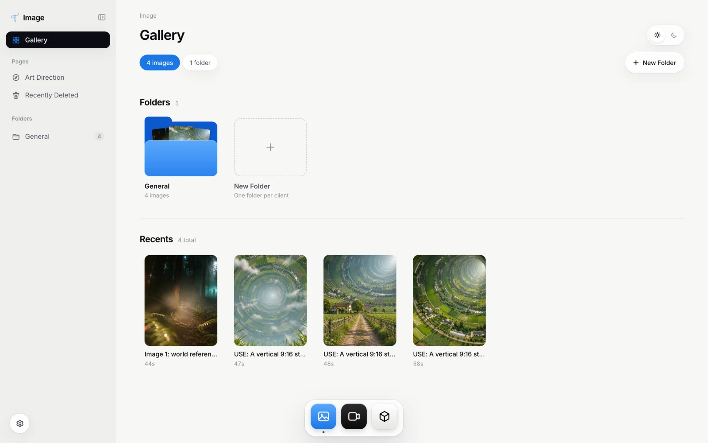
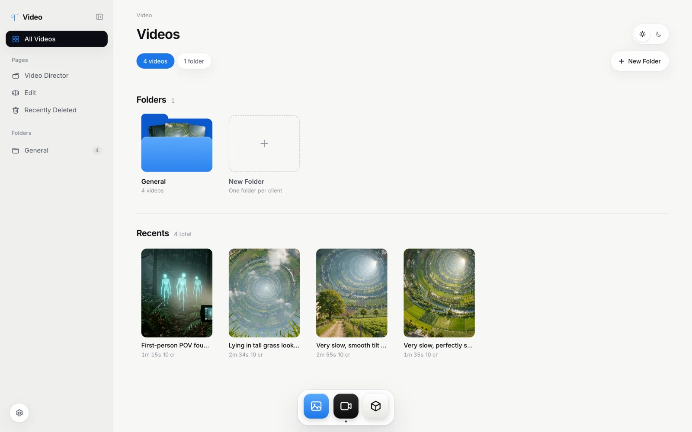
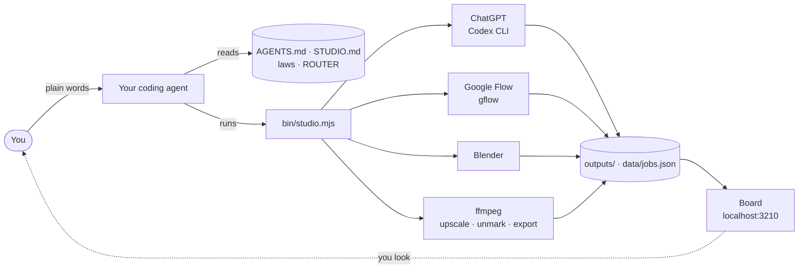
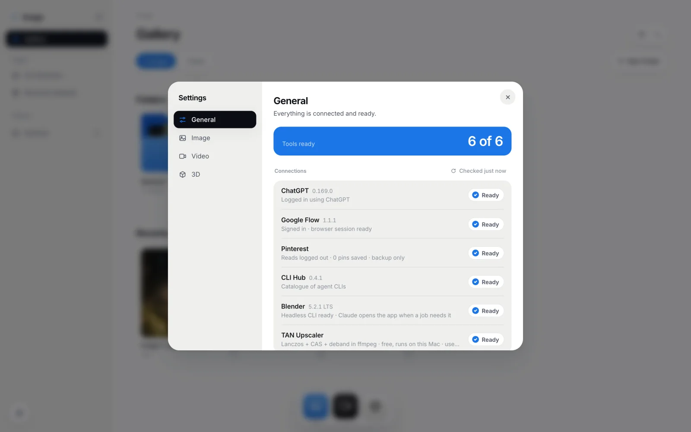

<p align="center">
  
</p>

<p align="center">
  <b>Tell your coding agent what you want. It makes the image, the video or the 3D shot.</b><br>
  An image, video and 3D studio run by Claude Code, Codex, Qwen Code, Gemini CLI or a local model.
</p>

<p align="center">
  <a href="LICENSE"></a>
  
  
  
</p>

---

## What it is

OpenTan Studio has no prompt box. You talk to your coding agent in plain words: *"a launch poster for my tea brand,
9:16"*, *"a 10-second slow push through a misty forest"*, *"a turntable of a brass lota"*. The agent does the rest:

- reads the studio's rulebook (`AGENTS.md`, `STUDIO.md`) and asks you **one** question first (the aspect ratio, and only
  what it can't work out);
- picks the art direction from your words and **one tool per job** (ChatGPT for finished stills, Google Flow for video,
  Blender for 3D);
- checks the credit cost before anything is spent, runs the job with one command (`bin/studio.mjs`), and checks the
  result;
- files every result in `outputs/clients/<client>/<date>/`.

The board in your browser shows the results. You never edit; you look, and you tell the agent what to change.

<p align="center"></p>

## What it makes

| | Engine | What you get |
|---|---|---|
| **Image** (the hub) | ChatGPT through the Codex CLI; Google Flow for drafts | Art Direction turns your words into a look (families of reference recipes). Client kits put the real logo in a corner, with its exact text and font. Every poster is checked by `studio verify` before you see it. |
| **Video** | Google Flow (Veo, Omni) | Video Director picks a studio (cinema, camera moves, lip sync, marketing …). Every clip is x1, the cheapest one for the exact length, with the price read from Flow's own panel first. The Edit page trims, splits and joins clips and exports 2K at 60 fps. |
| **3D** | Blender (headless + live) | 3D Director picks a shot (packshot, turntable, hero orbit, light-sweep reveal …). Renders land in Scenes; exported GLB models open in the board as live, turnable 3D. |

Upscaling (2K / 4K) runs on your Mac with ffmpeg, only when the use needs more pixels.

<p align="center"></p>

## How it works



## Quick start

You need macOS, Node 20+ and Google Chrome.

```bash
git clone https://github.com/thanmaiashok/opentan-studio
cd opentan-studio
npm install
node bin/studio.mjs doctor
```

`doctor` checks every tool and prints `ready`, `MISSING` or `off`, with the exact command that fixes each one. Fix the
rows top to bottom (your agent can do it: tell it *"read AGENTS.md and connect the tools"*). You do the sign-ins
yourself (ChatGPT, Google); the agent never types a password.

```bash
./start.sh    # the board, http://localhost:3210
./kill.sh     # stop it
```

<p align="center"></p>

## Works with any agent

| Agent | Reads |
|---|---|
| Claude Code | `CLAUDE.md` → `AGENTS.md` |
| Codex, Cursor, opencode | `AGENTS.md` |
| Qwen Code | `QWEN.md` (link to `AGENTS.md`) |
| Gemini CLI | `GEMINI.md` (link to `AGENTS.md`) |
| Any other / local model | point it at `AGENTS.md` |

## One tool per job

| Job | Tool | Start with |
|---|---|---|
| Poster, ad, hero still, text in an image | ChatGPT (Codex CLI) | `studio direct "<words>"` → `studio poster <brief>` |
| Many drafts, variations, characters | Google Flow | `studio image "<prompt>" --engine flow` |
| Video clip | Google Flow | `studio vdirect "<words>"` → `studio credits` → `studio video … --dry` |
| Join, trim, cut clips | the board's Edit page | — |
| Upscale (only when needed) | ffmpeg | `studio upscale <file> --to 2k\|4k` |
| 3D model, scene, render | Blender | `studio ddirect "<words>"` → `studio shot …` |
| Reference search (backup) | Pinterest (`pin`) | `studio pins search "<words>"` |
| A job nothing covers | CLI Hub | `cli-hub can "<job>"`, then ask you |

The full router, with when-not and never columns, is at the top of `STUDIO.md`.

## The rulebook

The studio runs on **numbered laws** in `STUDIO.md`: ask first, the owner's ratio is final, the logo goes in a corner,
prompts follow one structure, credits have a budget, and so on. Each law belongs to a director (Image, Video, 3D or
shared).

- Every new instruction you give becomes a law the same turn.
- Every mistake you catch becomes a row in `guide/MISTAKES.md` and an automatic check in `studio verify`, so it can't
  happen twice.

```bash
node bin/studio.mjs laws            # every law, by director
node bin/studio.mjs sec "logo"      # one section of the rulebook
node bin/studio.mjs                 # every command
```

## Safe by default

- **Local only.** The board listens on 127.0.0.1 and refuses requests from other sites or devices.
- **No secrets in the repo.** Sign-ins stay in each tool's own folder; keys go in `.env.local` (git-ignored).
- **Money needs you.** Plans and paid tools are your call. Flow jobs are refused when the balance can't be read or the
  panel's price doesn't match the plan.
- **AI marks.** The visible corner mark on Flow videos is removed with a map you measure from your own clip
  (`bin/markmap.py`); the invisible SynthID watermark is never touched.

## Repo map

```
AGENTS.md            start here (any agent): connect the tools, rules, every-session steps
STUDIO.md            the rulebook: router, workflows, numbered laws
bin/studio.mjs       the one command the agent runs
app/ components/     the board (Next.js)
lib/  app/api/       the board's server side (jobs, trash, files, video ingest, edits)
library/             art direction, video and 3D studios, prompts, the tool registry
tools/flow/          drives Google Flow (panel, price check, frames, downloads)
tools/blender/       the Blender kit and shot studios
guide/               prompting, Blender, edit, mistakes
```

Full map: `INDEX.md`.

## Not in this repo

Client kits, briefs and posters, licensed textures, study references and the measured mark maps stay on the owner's
machine. Yours appear when you use the studio: `--client "<name>"` makes a client folder, and `bin/markmap.py` measures
a mark map from a clip you made.

## Licence

MIT © 2026 Thanmai Ashok. Part of **OpenTan**, an open-source library by Thanmai Ashok.
