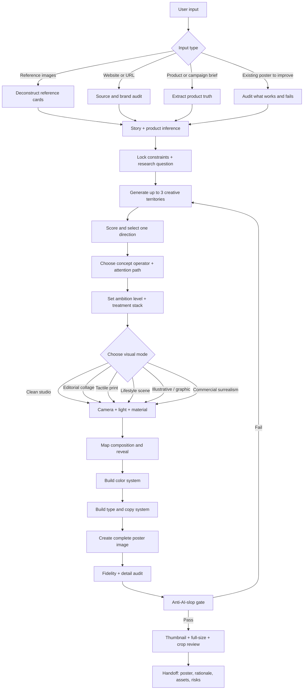

# Poster Art Director Workflow Map

This is the operating flow for turning references, links, product facts, and a creative brief into a directed poster. The goal is to make decisions visible and repeatable without flattening creativity into a template.

Use [art-direction-engine.md](art-direction-engine.md) to compare and approve creative directions. Record the project in [directing-sheet-template.md](directing-sheet-template.md) so evidence, assumptions, and approvals remain traceable.

## The master flow



The loop from the anti-AI-slop gate back to the concept is intentional. When a poster feels generic, polish is not the fix; the concept, carrier object, or reference lineage needs to change. Do not force three territories when the user has already locked a direction.

## Trigger map

| User gives you | Start here | Required output before generation |
| --- | --- | --- |
| One or more reference images | Reference deconstruction | Reference cards, shared patterns, differences worth preserving, copyright/provenance note |
| A website link | Source and brand audit | Research question, product facts, visual system, exact claims/copy, logo/packaging cues, audience, CTA, rights boundary |
| Product name and a vague “make it crazy” | Product truth + challenge lane | One unusual but relevant visual metaphor; do not add random surreal objects |
| Exact logo, packshot, and copy | Fidelity lane | Asset inventory, safe area, label/logo treatment, typography layout plan |
| “Make it realistic” | Realism lane | Camera, lens feel, light direction, surface response, contact shadow, reflection, and label fidelity |
| “Make it vintage/antique” | Material lane | Era/material reference, print process, palette, grain scale, and what remains modern/legible |
| “Make it popular/attractive” | Memorability lane | Instant-read hook, product-specific surprise, emotional tone, and share/crop behavior |
| An existing poster | Diagnostic lane | What to keep, what to remove, hierarchy repair, and a new concept sentence if necessary |
| A new batch of images | Library lane | Numbered assets, catalog entries, cross-reference patterns, and updated skill notes |

## Stage 0 — intake and constraints

Write a short brief before making visual decisions:

```text
Subject/product:
Audience:
Single message:
Exact copy:
Logo/packshot/assets:
Output channel and aspect ratio:
Desired emotion:
Research question:
Reveal level: full / hinted / suspenseful
Realism mode:
Rights or usage constraints:
```

If information is missing, make a reasonable assumption and mark it. Ask only when the missing fact would change the concept, legal boundary, or output format.

## Stage 1 — reference and source audit

Read [research-practice.md](research-practice.md) when references or links materially shape the direction. Study a target deeply enough to identify a repeated decision, and compare an outlier when a style, era, or creator is carrying the concept.

### For each image reference

Create a compact reference card with these fields:

1. **Job/story:** What does the image make the viewer feel or understand about the product?
2. **Attention path:** What is seen first, what moves the eye, what is read second, and where does the brand/proof/CTA land?
3. **Composition:** Central, diagonal, grid, stacked, top-down, split, framed, or environmental?
4. **Camera:** Macro, eye-level, low angle, top-down, three-quarter, wide, cropped, or portrait?
5. **Depth:** Background, midground, hero, foreground, and overlap logic.
6. **Physics:** What is believable? What is staged? What is intentionally impossible?
7. **Color:** Dominant field, hero color, counterpoint, neutral, contrast, and saturation rhythm.
8. **Typography:** Family/voice, scale, alignment, line breaks, script, hierarchy, and relationship to the hero.
9. **Material/realism:** Studio, lifestyle, collage, halftone, cutout, paper, gloss, condensation, grain, or illustration.
10. **Reveal:** What is hidden, cropped, torn, pixelated, or discovered gradually?
11. **Product truth:** What specific ingredient, use, texture, ritual, or benefit is embedded visually?
12. **Anti-slop risk:** What would become generic if copied without the original context?
13. **Rights note:** Supplied/owned, licensed, editorial reference, official brand asset, or unknown. If unknown, treat it as reference-only.

### For a website link

Use the appropriate browser/web tool and inspect the source rather than relying on the URL title. Capture:

- What the product actually is, who it is for, and what it promises.
- Brand colors, typography, logo behavior, packaging, photography, illustration, spacing, and recurring layout patterns.
- Exact product facts and claims; do not invent benefits or silently rewrite regulated claims.
- Primary CTA, offer, location, date/time, contact details, and any required legal copy.
- Visual assets that appear official versus third-party or editorial.
- Usage boundary: supplied by the user, officially published for brand reference, or unknown. Do not lift website imagery into a final poster without permission; use it to understand the system and request/reuse authorized assets.

Return a **source brief** before designing: brand truth, visual truth, audience truth, message opportunity, and rights boundary.

## Stage 2 — find the story inside the image

An image can communicate a story without explanatory copy. Read it through the following questions:

- What behavior is happening around the product?
- What human situation or ritual does it imply?
- What does the product make possible: refresh, escape, status, comfort, energy, belonging, discovery, appetite, or rebellion?
- Which visual detail is the proof of that story?
- What could be removed while preserving the story?

Convert the result into one sentence: **“For [audience], this product is [human meaning], shown by [visual action/object].”** This is the concept anchor.

## Stage 3 — choose the visual mode

Before choosing surface treatment, select the primary concept operator from [visual-concept-operators.md](visual-concept-operators.md), or state `direct` when the product/subject itself is the strongest idea. Name why the operator expresses the communication job. Do not select a technique because it is fashionable.

When the brief calls for experimental, maximal, damaged, retro, optical, or “crazy” work, read [effect-language.md](effect-language.md). Set the ambition level and design an ordered treatment stack by jobs. Name the recognition anchor that must survive.

Pick one primary mode and one supporting treatment:

| Mode | Use when | Must feel true |
| --- | --- | --- |
| Clean studio product | Shape, finish, ingredient, or label is the story | Light, contact, reflection, and silhouette |
| Lifestyle scene | Ritual, audience, or mood is the story | Human gesture, environment, time, and believable scale |
| Editorial collage | Contrast, culture, history, or layered meaning is the story | Edge logic, image lineage, type hierarchy, and material unity |
| Tactile print | Craft, nostalgia, local context, or physicality is the story | Ink/halftone/grain behavior and restrained imperfection |
| Illustrative graphic | Product is playful, simple, or conceptual | Shape language, silhouette, and intentional simplification |
| Commercial surrealism | A product truth benefits from an impossible metaphor | Accurate product plus disciplined altered physics |

Do not use “surreal” as a substitute for an idea. Name the specific rule being bent.

## Stage 4 — composition, camera, and reveal map

Before rendering, write a layout map:

```text
Format: 9:16 / 4:5 / 2:3 / 1:1 / landscape
Primary read: [hero or headline]
Primary concept operator:
Ambition level: refined / expressive / carrier / world-building
Attention path: first read → second read → proof/CTA
Treatment stack and order:
Clean recognition anchor:
Hero position and scale:
Camera/viewpoint:
Background field:
Depth planes:
Dominant gesture:
Reveal/suspense device:
Negative-space zone for copy:
Brand/logo zone:
Micro-detail zone:
```

### Camera/viewpoint choices

- **Macro/close:** taste, texture, condensation, label, premium detail, or mystery.
- **Eye-level three-quarter:** the safest product hero; clear silhouette and label with enough dimensionality.
- **Low angle:** power, energy, scale, heroism, or a product that dominates the world.
- **Top-down/flat lay:** ingredients, ritual, arrangement, graphic order, or social-friendly clarity.
- **Environmental wide:** product in a place, event, landscape, or experience; use when the world is part of the promise.
- **Cropped/abstract:** suspense, fashion, attitude, or a detail that becomes a symbol.

For an animated poster or motion extension, define camera movement as a motivated action: push toward the product, orbit to reveal a label, tilt with the pour, or pull back to reveal the environment. Avoid generic drift, random zoom, or movement that does not change understanding.

### Aspect-ratio decisions

- **9:16:** vertical reveal, stacked type, product rising/falling, ingredient cascade, or a central visual spine.
- **4:5 / 2:3:** hero plus ingredients, portrait/product relation, or flexible campaign poster.
- **1:1:** one icon-like idea; simplify supporting copy and keep the silhouette bold.
- **Landscape:** product-in-world, scene/relationship, before-after, or copy in intentional negative space.

## Stage 5 — color and typography system

### Color

Choose a relationship first: monochrome value range, complementary pair, warm/cool split, analogous appetite palette, or neutral plus one signal color. Then define:

```text
Field/base:
Hero/product:
Counterpoint/accent:
Type color:
Texture/neutral:
Where saturation peaks:
Where the eye rests:
```

Do not add colors just because they are available. Every extra color should identify a product cue, hierarchy level, or emotional turn.

### Type

Assign roles, not random font picks:

- **Display:** the headline or visual architecture.
- **Voice:** a supporting script, serif, or expressive line when it earns personality.
- **Utility:** facts, benefits, dates, price, CTA, or metadata.
- **Brand:** supplied logo/wordmark, never redrawn from memory.

Use real script support for multilingual work. Verify glyph coverage, reading direction, diacritics, line height, numerals, and optical weight across scripts.

## Stage 6 — build and integrate

Follow the active project's output mode. In this workspace, the complete-image generation rule governs unless the user explicitly chooses another production workflow:

1. Create the complete hero world and composition with the selected camera, material, light, physics, type hierarchy, and supplied pack/logo references in the generation brief.
2. Check product silhouette, pack/label fidelity, hand/ingredient anatomy, shadows, reflections, edge quality, and exact copy.
3. Regenerate when a critical element fails. Do not patch the result with an undisclosed layout or compositing pass.
4. If exact public-facing copy, legal information, price, logo, or pack cannot be rendered faithfully, report the limitation rather than fabricating accuracy.
5. Add micro-details only when they support the story: annotations, badges, coordinates, price, flavor, date, or specification.
6. Apply texture consistently across the system; never use grain to cover failed edges or empty thinking.

## Stage 7 — anti-AI-slop gate

Any “no” is a revision trigger:

1. Can the concept be stated in one specific sentence?
2. Is there one dominant hero or carrier object?
3. Does the primary visual operator make the product truth or message clearer?
4. Does the intended first → second → proof/CTA attention path actually work?
5. Do all treatment layers describe one coherent world, and does the recognition anchor survive?
6. Does the poster show something unique to this product or story?
7. Would the poster still work if the decorative shapes disappeared?
8. Is the palette derived from the product/reference and organized by hierarchy?
9. Does the camera/viewpoint make the product more desirable or more understandable?
10. Are physics, shadows, edges, and materials coherent—or intentionally broken for a named reason?
11. Is the typography doing structural or messaging work rather than filling space?
12. Is every claim, logo, label, date, and language accurate?
13. Could the same layout advertise a different product unchanged? If yes, redesign.
14. Is the reference influence visible as a principle but not a clone?
15. Does the poster have a memorable image or story at thumbnail size?

Hard fails include generic slogans, random icons, filler geometry, unmotivated glow, arbitrary grain, overstuffed information, fake multilingual text, inaccurate packaging, and an AI-generated logo or wordmark.

## Stage 8 — handoff package

Return:

- Final poster at requested dimensions and crop-safe versions if needed.
- One-sentence concept and short art-direction rationale.
- Palette and type roles.
- Reference lineage: which principles came from which references.
- Copy/brand asset checklist.
- Rights/copyright note and any unresolved assumptions.
- Anti-AI-slop gate result; if something failed, say what was fixed.
